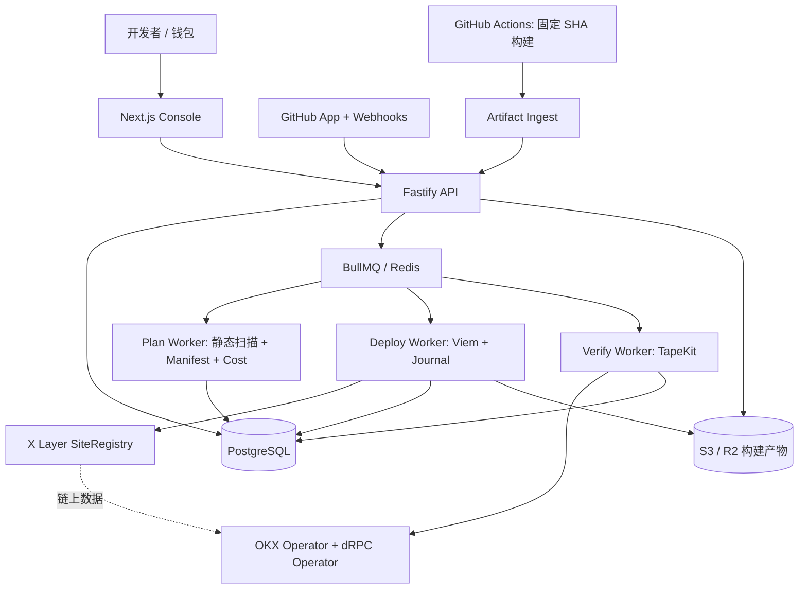

# TapeCI — 产品需求文档（PRD）与技术开发规范

> **版本**：v1.0 · 开发基线草案  
> **日期**：2026-10-19  
> **项目定位**：Git push → Verifiable DeWEB  
> **目标网络**：X Layer Mainnet（chainId 196）  
> **交付受众**：产品、前后端工程师、Web3 工程师、测试工程师、Codex Coding Agent  
> **状态**：可启动 P0 技术验证；**尚未实测主网端到端发布**

---

## 0. 阅读说明与决策摘要

本文件用于指导开发一个从 GitHub 仓库自动构建静态站点、在用户授权后写入 TapeOut DeWEB、并完成多 RPC 验证及可恢复版本管理的产品。本文既是 PRD，也是可交给 Codex 的工程任务约束文件；数据库可执行 DDL 另见 `schema.sql`，Codex 的执行规则另见 `AGENTS.md`。

**关键判断**：可借助现有 GitHub Actions、TapeKit、Viem 和 SiteRegistry 接口实现。**但 BNB Chain 的 TapeKit v0.2 规范不能自动等同于 X Layer 已验证写入 ABI**；必须先执行 P0，验证当前 X Layer 合约实现、授权模型、交易回执、读链行为和前端版本切换。P0 失败必须暂停链上写入实现，不可通过 mock 宣称主网已部署。

### 0.1 一页决策卡

| 项目 | 决策 |
|---|---|
| MVP 核心闭环 | GitHub 连接 → 构建 → Manifest/差异/费用 → 审批 → 分块上传 → TapeKit 验证 → 站点可访问 |
| 首个支持网络 | X Layer（196），不在 MVP 支持 BNB/Base 多链写入 |
| 首个构建框架 | Vite + React 静态站点；普通 HTML/CSS/JS 同时支持 |
| 构建执行 | P1 用本地/CLI；P2 使用用户仓库 GitHub Actions 及可核验构建产物 |
| 权限模式 | P0 手动钱包；MVP 可用**临时且隔离**的 Operator，但必须显式审批与限时；严格清单限制留待 ReleaseGuard |
| 版本策略 | 新文件写入不可变版本路径；旧版本保留；小于等于 24,000B 的入口文件最后覆盖 |
| 上传引擎 | 每文件 24,000B 分块、持久化事务记录、查询后恢复、每容器串行 |
| 部署验收 | 不能只看 `receipt.status=success`；还要同一区块、跨独立运营方读链核验文件哈希 |
| 非目标 | 不做动态后端托管、不做通用 PaaS、不做无条件无人值守主钱包代签、不自动流片 NFT |
| 上线阻断条件 | 合约实现变更、权限不确定、当前所有权不匹配、读链节点不一致、费用超预算、入口文件不可原子替换 |

### 0.2 证据等级与待验证事项

- **S1（规范）**：TapeKit `SPEC.md` v0.2 为 BNB Chain 规范草案，列出 `putFile`、`appendChunk`、`fileInfo`、`readRange`、`setOperator` 等 ABI 及限制。[R1]
- **S2（代码配置）**：TapeKit `kernel/src/config.js` 声明 X Layer 196 的 Factory、Opener、SiteRegistry、DomainBinding 地址、实现版本 allowlist 及两家独立 RPC 运营方要求。[R2]
- **S3（第三方复现）**：Cerebr 文档记录 2026-10-04 X Layer anvil fork 的协议验证，但非 TapeCI 自身的写入验证。[R3]
- **U（未验证）**：X Layer 当前 `SiteRegistry` 写入 ABI 是否与 v0.2 一致、`onlyEditor` 生效细节、`appendChunk` 恢复性、入口切换可用性、Gas 实测。**均列入 P0**。

---

## 1. 背景、问题与价值

### 1.1 目标用户

| 用户画像 | 当前痛点 | TapeCI 价值 |
|---|---|---|
| TapeOut Hackathon 开发者 | 部署多笔交易、频繁改动静态页面 | 用一次规范化流程完成构建、上传、验证 |
| AI Coding Agent 用户 | AI 能改代码，却不能安全自动部署到 DeWEB | Agent 只生成提交；TapeCI 负责构建与审批 |
| 小团队/DAO | 多人提交导致文件覆盖、发布记录不清 | Commit 与链上部署建立审计对应关系 |
| DeWEB 工具开发者 | 要自己实现分块、断点恢复、哈希验证 | 复用 `@tapeci/deployer` 和 `@tapeci/cli` |

### 1.2 用户旅程（Happy Path）

1. GitHub 登录 TapeCI，安装只访问所选仓库的 GitHub App。
2. 创建 Project，选择 `owner/repo`、`main`、构建命令、输出目录、目标链。
3. 连接钱包并绑定**由链上派生**的 TapeOut 容器，实时验证 NFT 的当前持有人/容器是否已开通。
4. Push 新 Commit 后，GitHub Actions 在**精确 Commit SHA** 构建站点，将构建产物提交 TapeCI 校验。
5. TapeCI 检查路径/文件大小/外链/运行模式，计算 SHA-256、版本 Manifest、链上差异和费用上限。
6. 用户查看文件清单、交易数量、部署费、目标容器与 Operator 有效期后审批。
7. Worker 串行写入版本化资源并验证；最后一次 `putFile(index.html)` 触发版本切换。
8. TapeKit 在一致区块通过至少两家独立 RPC 运营方校验文件，输出验证证据、交易列表与访问链接。
9. 如需回滚，重用保留的旧版资源，仅重写入口文件（前提：历史资源仍可验证）。

### 1.3 目标与可衡量验收

- P0：至少一个**独立测试容器**在 X Layer 上实现写入 + TapeKit 验证的实测证据包。
- MVP E2E：用户完成初次发布、二次增量发布、失败续传、回滚各 1 次真实网络验证。
- 正确性：同一个 Webhook 重放 10 次仅产生一个业务部署；失败后不会重复 append 同一块。
- 可追溯性：每个 Live 版本都关联 Commit、Manifest SHA-256、授权证据、交易哈希与验证区块。
- 发布门禁：验证失败时不得标记 LIVE，且不得切换入口。
- 质量门槛：核心包单元测试覆盖率目标 ≥80%，关键状态机与权限路径须有集成测试。

---

## 2. 范围与优先级

### 2.1 Must-have（MVP）

| ID | 功能 | 验收要点 |
|---|---|---|
| F01 | GitHub 安装/仓库绑定 | 只读所选仓库；卸载 App 后不可再发起构建 |
| F02 | 钱包登录与容器绑定 | SIWE 风格挑战签名；当前 owner 与派生容器一致 |
| F03 | 静态项目构建 | 固定 Commit；默认 Vite；可配置 `buildCommand` 和 `distDir` |
| F04 | 安全静态扫描 | 拒绝非法路径、超限文件、symlink、动态服务端依赖及不受支持的入口 |
| F05 | Manifest 与部署计划 | 版本化资源、确定性摘要、差异集合、Chunk 数与预计成本 |
| F06 | 审批 | 对部署计划摘要和目标容器审批，失败后审批不复用到修改后的 Manifest |
| F07 | SiteRegistry 上传 | 24kB 块、每容器串行、可恢复状态、交易回执记录 |
| F08 | 链上回读核验 | 固定区块，两家独立运营商读出一致、size 与 SHA-256 完全匹配 |
| F09 | 入口切换、历史及回滚 | 仅在资源齐备后切换；历史版本保留且验证后可回滚 |
| F10 | 控制台与日志 | 任务时间线、文件状态、费用、错误信息、DeWEB 链接 |

### 2.2 Should-have（二期）

- Pull Request 链下隔离预览、站点健康监控、通知（Telegram/Discord）。
- 自定义域名、团队协作审批、发布规则、自有 RPC、自托管 Worker。
- 规范化 `@tapeci/deployer` SDK 与 CLI 公共 npm 发布。

### 2.3 Won't-have（MVP 不做）

- 服务器端渲染/数据库/任意 Docker 镜像运行；后端 API 另由现有云服务托管。
- TapeOut NFT 铸造、流片、Container 开通的一站式代付；用户应先具备有效容器。
- 无需人类批准的、掌握用户主钱包的全自动部署。
- 对上传内容真实性、合法性或业务安全的担保（链上哈希只证明一致性）。
- 大型多链 ReleaseGuard 审计与自动跨链镜像部署。

---

## 3. TapeOut / X Layer 技术约束

### 3.1 P0 需要采集的网络配置

**从 TapeKit 公开代码读取的 X Layer 配置快照（仅用于初始验证，不可代替部署前链上读取）**：[R2]

| 字段 | 值 |
|---|---|
| Chain ID | `196` |
| Native gas token | `OKB` |
| Factory | `0x1f09daefa827f02cbb40967cc91b259763760761` |
| Opener | `0x536add8f30f03b69f6fbf29d425a816a0dc50106` |
| SiteRegistry Proxy | `0xd6efb7adcc9c83dc4924ad56f6a8e4e969b9adb6` |
| DomainBinding Proxy | `0x68809fd2fb343aa57d0aeb7f33defe477c9666f9` |
| TapeKit 已知 SiteRegistry 实现 | `0xa85c4143d1d4a77f54b8e4ecc9e6d1418afea45f` |
| TapeKit 已知 DomainBinding 实现 | `0x5ebf29b80789e548907c707530c3c7607c4347df` |
| RPC Operator group | `okx` 与 `drpc`；同一运营方多个域名**不算多票** |

应用启动读取配置时必须核对链 ID、`eth_getCode`、ERC-1967 implementation slot、合约 ABI 选择器、Network RPC 健康度；如果实现版本变化，**拒绝继续写入**并标记 `IMPLEMENTATION_CHANGED`。

### 3.2 规范中的文件限制

依据 TapeKit v0.2：[R1]

- `CHUNK_MAX = 24_000 bytes`；`putFile` 初始块，`appendChunk` 通过 `expectIndex` 保证顺序。
- 单文件最多 `350` 块、最多 `8_400_000 bytes`。
- 文件大于 `96 KiB` 时采用 `readRange`，所有分段与元信息读取绑定同一区块。
- 文件哈希为**原始字节 SHA-256**，不是以太坊 Keccak-256；不能混用。
- `fileInfo` 在 `chunkCount === 0` 时表示不存在；所有零哈希不能显示为已验证。
- 规范要求严格的路径规范化（查询参数剥离、percent decode、NFC、拒绝 `.`/`..`），务必采用 TapeKit 同等规则。
- 客户端读取一个站点时使用单个固定区块，且至少两个**不同运营商**响应一致；发生差异应拒绝验证而非“多数票通过”。

### 3.3 必须重新确认的写入 ABI

```solidity
interface ISiteRegistryWriteCandidate {
    function putFile(address container, string calldata path, string calldata contentType, bytes32 sha256Hash, bytes calldata data) external;
    function appendChunk(address container, string calldata path, uint256 expectIndex, bytes calldata data) external;
    function removeFile(address container, string calldata path) external;
    function setFallback(address container, string calldata path) external;
    function setOperator(address container, address op, uint256 ttl) external;
    function fileInfo(address container, string calldata path) external view returns (uint32 size, string memory contentType, bytes32 sha256Hash, uint40 updatedAt, uint256 chunkCount);
    function readRange(address container, string calldata path, uint256 offset, uint256 len) external view returns (bytes memory);
}
```

以上为 **BNB 规范中的候选接口**；只有 P0 验证 X Layer 当前字节码/交易调用后，才写入最终 ABI 文件 `packages/chain/abis/xlayer/`，并提交带区块号的证据。

### 3.4 链上容器身份校验

绑定容器不得只相信前端传入的地址。须：

1. `cpuAt(processorIndex)` 获取处理器合约。
2. `accountOf(processor, tokenId)` 派生容器；与用户输入容器地址做大小写无关地址比对。
3. `ownerOf(tokenId)` 检查当前 NFT 持有人或经验证的授权控制策略。
4. `isOpened(processor, tokenId)` 确认容器可用。
5. 写入前重复所有权与实现版本检查；缓存不得作为授权凭据。
6. 链上 SiteRegistry / DomainBinding 状态与可访问性分开检查：**上传成功不等于站点已激活或客户端可访问**。

---

## 4. 目标架构与信任边界



### 4.1 组件责任

| 组件 | 责任 | 不负责 |
|---|---|---|
| Console | GitHub 绑定、钱包证明、版本审批、日志 | 不持久保存私钥，不直接判定链上验证结果 |
| API | 用户/项目/仓库授权、幂等 Webhook、产物登记 | 不执行来自仓库的任意 shell |
| Build runner | 固定 Commit 构建、打包、产物证明 | 不持有链上写入账户私钥 |
| Plan Worker | 内容静态检查、文件差异、交易计划 | 不修改链上状态 |
| Deploy Worker | 交易队列、nonce、签名、上传、续传 | 不擅自更改已批准 Manifest |
| Verify Worker | TapeKit 读取并核验、保存证据 | 不以单 RPC/单次回执宣告 Verified |
| Object Store | 限时保存待发布压缩包和 Manifest | 不作为 DeWEB 正式文件来源 |

### 4.2 GitHub Actions 集成策略

MVP 采取**用户仓库内运行 workflow**：避免 TapeCI 服务端执行任意不可信仓库脚本。GitHub App 读取所选仓库和 Webhook 事件；Action 按固定 SHA 构建并提交产物。

- GitHub App 权限最小化：Metadata（必需）、Contents Read（按需）、Checks Write（可选）；默认**不要求仓库写权限**。
- `push` 事件过滤被授权 repo ID + 分支 + Commit；通过 `X-Hub-Signature-256` 常时间比较原始请求体签名。[R4]
- 验证 `X-GitHub-Delivery` 与 `installation_id`、`repository_id`，按 delivery_id 去重；防止重放引起重复计费。
- Action 使用**固定版本的构建依赖及 actions SHA**、`permissions: id-token: write, contents: read`；向 TapeCI 后端提交 OIDC ID Token 并经后端核对 issuer/audience/repository_id/ref/sha/workflow_ref，换取短时单次上传许可。
- 构建产物上传使用短时一次性令牌、大小上限、内容哈希与过期时间；产物服务器须扫描 tar path traversal/symlink/特殊文件。
- `pull_request` 的不可信代码不得继承写入权限或部署密钥。PR 只做检查与预览，不做链上发布。
- 构建在 GitHub Runner 完成不代表“可信执行环境证明”；要显示为“固定 Commit 的 GitHub CI 产物”，不要表述成密码学可证明构建。

**优先实现顺序**：P0 CLI 本地构建 → P1 命令行部署 → P2 GitHub App + Actions OIDC，避免第一天就引入 App 审核与 Actions 集成复杂性。

---

## 5. 发布规范：Manifest、版本与回滚

### 5.1 Manifest v1 JSON Schema（概念结构）

```json
{
  "schemaVersion": "tapeci.release.v1",
  "chainId": 196,
  "siteRegistry": "0x...",
  "container": "0x...",
  "repositoryId": 123456,
  "commitSha": "0123456789abcdef0123456789abcdef01234567",
  "releaseId": "r-0123456789ab-ab12cd34",
  "entryPath": "index.html",
  "fallbackPath": "index.html",
  "files": [
    {"path":"releases/r-.../assets/app.abcdef12.js","size":12345,"sha256":"0x...","contentType":"text/javascript","chunks":1},
    {"path":"index.html","size":350,"sha256":"0x...","contentType":"text/html","chunks":1}
  ],
  "plan": {"writes":2,"deletes":0,"gasLimitWei":"0"}
}
```

实际 manifest 不得将 `gasLimitWei` 与文件输入一起当作纯内容哈希混用。**推荐区分**：

1. `artifactDigest = SHA256(确定性序列化的文件路径、文件 size、字节 SHA256)`。
2. `releaseManifestHash = SHA256(canonical JSON 的发布清单，不含时间戳/动态 gas 估算)`。
3. `approvalDigest = EIP-712(chainId, SiteRegistry, container, releaseManifestHash, costCeiling, nonce, expiresAt)`。

所有参与哈希的路径排序为 UTF-8 字节序、按 NFC 规范化、无 BOM、无不可确定字段。必须编写跨平台测试（macOS/Windows/Linux），同一构建结果得到同一 `releaseManifestHash`。

### 5.2 原子切换能力与边界

现有 SiteRegistry 的 `putFile` 对每个文件独立提交交易，**无法对整个目录跨交易原子更新**。MVP 使用以下受限策略：

- 构建器将除根入口外的文件部署到 `releases/<releaseId>/...`，保证**从不覆盖旧版本资源**。
- `index.html` 是唯一受控入口文件，必须 ≤ 24,000 字节，且为**单笔交易**完整覆盖。
- 入口 HTML 中只使用版本化资源；最终 `index.html` 切换之前，验证所有引用资源的长度和哈希。
- 需要处理 Vite `base`、动态 import、CSS `url()`、manifest、favicon、SPA fallback、绝对地址引用和 Service Worker 缓存，未通过对应静态检查则不能宣称安全切换。
- 同一个 Container 同时只允许一个活动部署任务；读取端采用 TapeKit 固定区块快照策略，避免单次渲染跨版本混读。
- 发布成功后保留至少最近 5 个可恢复版本；不要在 MVP 自动删除旧版本资源。

**回滚**：先验证目标历史 Manifest 的文件仍存在且哈希匹配；然后重新写 `index.html`，复核新的入口与其目标资源。历史资源若不完整，必须先重传，禁止直接改入口。

### 5.3 差异比较与删除策略

- 比较**目标路径 + byte hash + size + contentType**，一致时跳过上传。
- 存在同路径、不同 hash 时一般视为冲突，除受控 `index.html` 切换外禁止直接覆盖可变路径。
- `removeFile` 不在 MVP 自动执行，以免删掉历史版本仍引用的文件。
- 存储清理属于二期，需要引用计数和保留策略，不应默认自动清理链上旧版本。

---

## 6. 分块上传、续传与链上校验

### 6.1 单文件上传算法

```typescript
// PSEUDOCODE — 必须完成 P0 ABI 验证后替换为正式实现。
async function deployOneFile(job: DeploymentJob, file: ArtifactFile) {
  await assertSameChainAndImplementation(job.chainId, job.registry);
  await assertCurrentOwnershipAndOperator(job.container);
  await assertApprovedManifest(job.releaseManifestHash, job.approval);

  const body = await loadAndVerifyArtifactBytes(file.objectKey, file.sha256);
  const chunks = chunkBytes(body, 24_000);
  const current = await registry.fileInfo(job.container, file.targetPath);

  if (current.size === body.length && current.sha256Hash === file.sha256) {
    await verifyPinnedRead(job.container, file.targetPath, file.sha256);
    return 'UNCHANGED';
  }

  // 如果已有相同目标哈希且 chunkCount > 0，逐块检查已上传的前缀。
  // 仅在已上传块与计划前缀一致时继续；否则标记 CONFLICT，不做盲目覆盖。
  const nextIndex = await reconcileOnChainPrefix(current, chunks, file);
  if (nextIndex === 0) {
    await sendAndJournal('putFile', [job.container, file.targetPath, file.contentType, file.sha256, chunks[0]]);
  }
  for (let i = Math.max(1, nextIndex); i < chunks.length; i++) {
    await assertDeploymentStillAuthorized(job);
    await sendAndJournal('appendChunk', [job.container, file.targetPath, BigInt(i), chunks[i]]);
  }
  await verifyPinnedRead(job.container, file.targetPath, file.sha256);
}
```

**必须说明**：如果当前版本的合约不支持可靠读取尚未完成文件的全部已写字节，仅凭 `fileInfo.chunkCount` 并不能证明前缀正确。遇到恢复证据不足时应停止并标记 `RECOVERY_REQUIRES_RESTART`；可在用户重新审批且路径不影响线上版本的前提下，从 Chunk 0 覆盖重传。禁止猜测或盲目 append。

### 6.2 状态机

`RECEIVED → BUILDING → BUILT → VALIDATING → PLAN_READY → AWAITING_APPROVAL → APPROVED → UPLOADING_ASSETS → VERIFYING_ASSETS → SWITCHING_ENTRY → VERIFYING_RELEASE → LIVE`

异常终态或暂停态：

`BUILD_FAILED / PLAN_REJECTED / APPROVAL_EXPIRED / AUTH_REVOKED / OWNERSHIP_CHANGED / INSUFFICIENT_BALANCE / FEE_OVER_BUDGET / RPC_DISAGREEMENT / CHAIN_REORG_PENDING / IMPLEMENTATION_CHANGED / UPLOAD_CONFLICT / UPLOAD_INTERRUPTED / VERIFY_FAILED / SWITCH_FAILED / ROLLBACK_REQUIRED / CANCELED`

迁移条件：每次状态变更写入 `deployment_events`，并带事件来源、发生时间、事务编号；Worker 用乐观版本号/CAS 保证并发状态迁移不重复。

### 6.3 交易管理

- 任何广播前记录交易 **intent**、目标合约、调用函数、参数哈希、预计 Gas、链 nonce 和业务幂等键。
- 对同一 EOA 账户串行调度 nonce；广播后保存 transactionHash，重启时优先查询回执和交易池，再决定是否替换费率/重播同 nonce。
- `eth_sendRawTransaction` 超时不等于未广播；不能直接发送第二笔同逻辑、不同 nonce 的 `appendChunk`。
- 交易成功不等于文件完整；每次完整文件写入结束后必须执行字节级校验。
- “链上已打包”和“达到 X Layer safe/finalized 策略”分开显示；安全标签来自真实 `safe`/`finalized` 区块读取，不得写死固定分钟数。

### 6.4 TapeKit VerificationReport

```typescript
export interface VerificationReport {
  chainId: 196;
  container: `0x${string}`;
  registry: `0x${string}`;
  pinnedBlockNumber: bigint;
  observedAt: string;
  nodeOperators: string[];          // 至少两家不同运营方
  registryImplementation: `0x${string}`;
  bindingImplementation: `0x${string}`;
  checks: Array<{
    path: string;
    expectedSha256: `0x${string}`;
    actualSha256: `0x${string}`;
    expectedSize: number;
    actualSize: number;
    matched: boolean;
  }>;
  status: 'VERIFIED' | 'DISAGREEMENT' | 'UNSUPPORTED_IMPLEMENTATION' | 'INCOMPLETE';
}
```

验证证据存储为 JSON，保留对应区块号、哈希、节点运营方、实现版本及文件检查结果。`VERIFIED` 只是某固定区块可观察到的一致性结论，不代替更强的 L2 终局性保证。

---

## 7. 身份、授权与威胁模型

### 7.1 身份模型

- **GitHub 登录** 证明用户可使用相应 GitHub 账户；不能证明其拥有链上 Container。
- **钱包挑战签名**（带域名、Nonce、过期时间、Chain ID）证明当前用户控制特定 EOA；不能代替 NFT 的实时持有权检查。
- **Container 绑定** 通过 factory/opener/NFT 链上数据确定，不可任意自报。
- **发布 Operator** 是具有写入风险的独立受限时效账户；SiteRegistry 的 `setOperator` 不提供按文件/Manifest 粒度限制。
- **ReleaseGuard**（二期）才可能提供严格的路径/Manifest 级强制约束；需设计、测试和外部审计。

### 7.2 MVP 最小安全规则

1. 禁止接收或托管用户 NFT 主钱包私钥。
2. 每项目独立部署 Operator 地址；密钥存放受管密钥服务/KMS，加密且不进入 GitHub Actions。若不能做到，MVP 暂时只支持钱包逐笔签名。
3. 所有临时 Operator 授权显式展示 TTL、链 ID、SiteRegistry、Container、风险提示；权限到期或 NFT 转移后禁止继续部署。
4. 发布计划审批绑定 Manifest 摘要、目标容器、费用上限、nonce、到期时间；审批后任何内容变化都需再次审批。
5. 不允许普通 PR 构建读取生产部署凭据；在生产 Action 中不运行未经合并的 fork PR 代码。
6. Webhook 使用原始请求体 HMAC-SHA256 验证和事件幂等；外部回调/上传限制速率、大小、类型和来源。
7. 记录敏感配置访问和权限改变；日志必须脱敏 GitHub Token、OIDC JWT、KMS 句柄与私钥材料。
8. 禁止未经授权的跨项目查询、跨容器部署；资源级授权检查覆盖每个 API。
9. 遇到实现升级、链重组、RPC 分歧、nonce 冲突、预算超限，Fail Closed。
10. 不对包含任意外部 URL 的网站授予“100% 链上”标记；该标记应遵守 TapeKit 的静态/运行期标准。

### 7.3 威胁矩阵

| 威胁 | 风险 | 防护 | 对应测试 |
|---|---|---|---|
| 伪造 GitHub Webhook | 无授权部署 | HMAC + install/repo/ref 检查 + 去重 | SEC-01/02 |
| 恶意构建产物路径 | 任意文件覆盖/污染 | 解包路径限制、symlink 与特殊文件拒绝 | SEC-03 |
| Operator 密钥泄露 | 篡改站点 | 独立低余额、短时、KMS、主动撤销 | SEC-04 |
| Manifest 审批后被替换 | 攻击者代码上线 | 哈希绑定和后端二次计算 | SEC-05 |
| RPC 分歧或被代理 | 伪验证 | 不同运营方精确一致，否则失败 | SEC-06 |
| UUPS 实现升级 | ABI/行为变化 | ERC-1967 slot allowlist、自动停写 | SEC-07 |
| 并发部署竞争 | 半更新、文件覆盖 | 每容器串行队列 + CAS + nonce 锁 | SEC-08 |
| 余额/费用暴涨 | 用户损失 | 用户审定 fee cap、逐交易预估 | SEC-09 |

---

## 8. 数据库设计与索引

本仓库附有可执行 `schema.sql`。以下列明核心实体、关联和一致性规则。

| 表名 | 主键 | 关键字段 | 关键唯一性/关联 |
|---|---|---|---|
| `users` | UUID | github_user_id | github_user_id 唯一 |
| `wallets` | UUID | user_id,address,verified_at | (user_id,chain_id,address) 唯一 |
| `github_installations` | UUID | installation_id,account_login | installation_id 唯一 |
| `projects` | UUID | owner_user_id,repo_id,branch,chain_id,container_id | (repo_id,branch,container_id) 唯一 |
| `containers` | UUID | chain_id,processor_address,token_id,container_address | (chain_id,container_address) 唯一 |
| `deployments` | UUID | project_id,commit_sha,state,manifest_hash,approval_* | (project_id,commit_sha,trigger_kind) 去重 |
| `release_files` | UUID | deployment_id,path,sha256,size,chunk_count,state | (deployment_id,path) 唯一 |
| `chain_transactions` | UUID | deployment_id,file_id,nonce,tx_hash,state | (chain_id,tx_hash) 非空唯一 |
| `deployment_events` | BIGSERIAL | deployment_id,old_state,new_state,payload | 为审计写入追加事件 |
| `releases` | UUID | project_id,deployment_id,entry_sha256,release_id,manifest_hash | (project_id,release_id) 唯一 |
| `approvals` | UUID | deployment_id,signer,approval_digest,expires_at | 审批不得跨部署复用 |
| `webhook_deliveries` | UUID | delivery_id,installation_id,event_type | delivery_id 唯一 |

必须具备：

- `deployments.version` 用于 CAS 状态转移。
- 仅允许一个 Container 有一个“正在进行的链上发布”任务，通过 PostgreSQL partial unique index 或租约锁实现。
- 所有可疑重试先做链上协调，不根据数据库 alone 推断链上进度。
- 事务、状态变迁、审批、文件上传分离建表；`tx_hash` 不能覆盖历史记录。
- 对 `siteRegistry`、network 和 `container` 等来源数据保留链上读取块与配置版本。

---

## 9. API 与错误约定

### 9.1 REST API 草案

| Method | Path | 作用 / 权限 |
|---|---|---|
| GET | `/v1/me` | 登录身份 |
| POST | `/v1/auth/wallet/challenge` | 生成钱包随机挑战 |
| POST | `/v1/auth/wallet/verify` | 验签并建立钱包关联 |
| GET | `/v1/github/installations` | 列举用户授权的 GitHub App 安装 |
| POST | `/v1/projects` | 创建项目；需要 Repo & Container 合法性校验 |
| GET | `/v1/projects/:id` | 读取项目；项目成员权限 |
| POST | `/v1/projects/:id/deployments` | 手动部署；带 `Idempotency-Key` |
| POST | `/v1/github/webhook` | GitHub 签名验证、入队 |
| POST | `/v1/builds/token` | 验证 GitHub OIDC，获取一次性上传令牌 |
| POST | `/v1/builds/artifacts` | 上传 Artifact + 校验（流式/对象存储直传） |
| GET | `/v1/deployments/:id/plan` | 文件差异、Gas 估算、待审批内容 |
| POST | `/v1/deployments/:id/approve` | 提交钱包签名与预算上限 |
| POST | `/v1/deployments/:id/execute` | 满足权限与安全条件后执行 |
| GET | `/v1/deployments/:id/events` | 分页事件/日志 |
| GET | `/v1/deployments/:id/verification` | 下载验证报告 |
| POST | `/v1/projects/:id/rollback` | 回滚指定 release，仍需批准 |
| GET | `/v1/projects/:id/releases` | 历史发布 |

### 9.2 典型请求：审批

```json
{
  "deploymentId":"UUID",
  "chainId":196,
  "container":"0x...",
  "manifestHash":"0x...",
  "gasCostCeilingWei":"50000000000000000",
  "expiresAt":"2026-10-19T23:00:00Z",
  "nonce":"UUID-or-unique-counter",
  "signature":"0x..."
}
```

真实审批签名字段由 EIP-712 类型定义固定。若使用普通 EOA 签名/交易批准，不得把 REST 审批当成能限制 Operator 写入范围的链上防护；这是**平台流程校验**而非智能合约强制保证。

### 9.3 标准错误体

```json
{
  "error": {
    "code": "IMPLEMENTATION_CHANGED",
    "message": "X Layer registry implementation not in allowlist",
    "retryable": false,
    "details": {"chainId": 196, "container": "0x..."}
  },
  "requestId": "uuid"
}
```

常用错误码：`INVALID_WEBHOOK_SIGNATURE`、`REPOSITORY_NOT_AUTHORIZED`、`CONTAINER_NOT_OPEN`、`NOT_CURRENT_OWNER`、`ARTIFACT_INVALID`、`PLAN_STALE`、`APPROVAL_REQUIRED`、`APPROVAL_EXPIRED`、`FEE_OVER_BUDGET`、`UPLOAD_CONFLICT`、`RPC_DISAGREEMENT`、`IMPLEMENTATION_CHANGED`、`VERIFICATION_FAILED`。

---

## 10. 前端页面与交互规范

| 页面 | MVP 必须展示 | 关键动作 |
|---|---|---|
| Dashboard | 项目数、最近部署、链上状态 | 创建项目 |
| Project Wizard | GitHub repo、分支、构建命令、容器、网络 | 校验权限与保存 |
| Deployment List | Commit、发布状态、耗时、发起者 | 打开明细 |
| Deployment Detail | 状态时间线、文件表、交易表、错误原因、验证证据 | 查看 Logs / 重试 / 回滚 |
| Plan & Approval | Changed Files、Chunk、费用范围、Operator TTL | 钱包审批、终止 |
| Container Settings | 当前 Owner、Factory、Opener、Registry、授权有效期 | 更换容器 / 撤销权限 |

交互必须区分 4 个状态：`Build Success`（仅构建通过）、`Uploaded`（部分或全部交易上链）、`Verified`（按固定块核验完整）和 `Live`（入口已切换、完整版本可读取且容器处于可访问状态）。不可因为编译成功就展示“部署成功”。

视觉建议：暗色控制台，浅色阅读面板；交易、费用、日志均采用等宽字体；风险提醒用明确的文字和动作，不仅依赖颜色。移动端只读优先，复杂审批在桌面优先完成。

---

## 11. 仓库结构与实现约束

```text
TapeCI/
├── apps/
│   ├── web/                    # Next.js + Wagmi UI
│   └── api/                    # Fastify + GitHub App/OIDC
├── packages/
│   ├── config/                 # Chain allowlist, runtime checks
│   ├── database/               # Drizzle + SQL migration
│   ├── github/                 # webhook, app auth, artifact ingest
│   ├── artifact/               # deterministic manifest, safe unzip
│   ├── validator/              # compatibility and path validation
│   ├── chain/                  # ABI, Viem, fee estimation
│   ├── deployer/               # journal, chunk upload, reconcile
│   ├── verifier/               # TapeKit pinned read reports
│   ├── release/                # entry cutover and rollback
│   ├── cli/                    # init/build/plan/deploy/verify/rollback
│   └── shared/                 # types, error codes, validation
├── workers/
│   ├── planning-worker/
│   ├── deployment-worker/
│   └── verification-worker/
├── contracts/                  # ReleaseGuard [P3 optional]
├── docs/
├── tests/
│   ├── unit/
│   ├── integration/
│   ├── fork/
│   └── e2e/
├── infra/
├── .github/workflows/
├── pnpm-workspace.yaml
└── AGENTS.md
```

技术版本：Node 22 LTS（如后续调整要显式记录）、TypeScript strict、pnpm workspace、Vitest、Playwright、PostgreSQL 16+、Redis 7+、Viem。依赖版本应锁定；不建议在执行时自动升级到 major latest。

---

## 12. 分阶段任务清单（Codex 可逐项执行）

**规则**：只可在上游依赖任务验收通过后开始下游依赖任务。完成任何任务需提交代码、测试、文档和实际执行结果（含 SHA/区块/日志）；失败要记录 blocker，禁止把 Mock 的 PASS 当作主网 PASS。

### Phase P0：链上技术核验（阻断门）

| ID | 任务 | 交付物 | 验收/DoD |
|---|---|---|---|
| P0-01 | 锁定 TapeKit 依赖 Commit，读取配置 | `docs/evidence/sources.md` | 记录源 Commit、日期与网络配置 |
| P0-02 | 读 X Layer 合约 bytecode/implementation | `chain-probe.json` | chainId=196，EIP-1967 slot 与 allowlist 一致 |
| P0-03 | 校验候选 ABI selectors 与返回值 | `abi-validation.md` | fileInfo/putFile/appendChunk/Operator 调用签名可确认 |
| P0-04 | Fork 上建测试容器并验证授权 | fork 测试脚本 | 不使用真实主钱包资金；非法 Operator 被拒绝 |
| P0-05 | Fork 测试分块写入与断点恢复 | `upload-fork.spec.ts` | 1、24k、24k+1、65k、非法 index 用例通过 |
| P0-06 | TapeKit 回读与多运营方一致性 | `verification-evidence.json` | 相同 pinned block；Node Operator 不同；SHA 一致 |
| P0-07 | X Layer 小额主网 smoke test（授权后） | 交易哈希 + UI 访问证据 | 用户明确允许实际链上花费；站点真实可访问 |
| **P0-GATE** | 复核安全、预算、ABI 与结论 | `docs/P0_DECISION.md` | **GO / NO-GO**，未 GO 不进入 P1 写链模块 |

### Phase P1：CLI 与发布引擎

| ID | 前置 | 任务 | DoD |
|---|---|---|---|
| P1-01 | P0 | Monorepo + CI + lint + TypeScript strict | CI 可复现 |
| P1-02 | P1-01 | `.tapeci.json` 配置 Schema | 有错误配置测试 |
| P1-03 | P1-01 | 安全静态产物扫描 | 拒绝 ../、symlink、>8.4MB、外链政策违规 |
| P1-04 | P1-02/03 | Manifest canonicalization + sha256 | 相同字节跨平台 hash 一致 |
| P1-05 | P0/P1-04 | 链上差异计划与估价 | 文件数、Chunks、估价、预算上限可复核 |
| P1-06 | P0/P1-05 | 分块写入 + journal + nonce lock | 重启后恢复，禁止重复 append |
| P1-07 | P1-06 | TapeKit VerificationReport | 双运营方、pinned block、size/hash 一致 |
| P1-08 | P1-07 | 入口文件单交易切换与回滚 | 旧版可访问，失败不切换 |
| P1-09 | P1-08 | CLI 命令 + 文档 | `init/build/validate/plan/deploy/verify/rollback` 可用 |

### Phase P2：云端 SaaS 与 GitHub 自动化

| ID | 前置 | 任务 | DoD |
|---|---|---|---|
| P2-01 | P1-01 | SQL Schema + Drizzle 对照 | migration up/down 测试（回退不删审计数据） |
| P2-02 | P2-01 | GitHub App OAuth/installation | 仅目标仓库可读，卸载立即拒绝 |
| P2-03 | P2-02 | Webhook HMAC + dedup | 无效签名拒绝，10 次重放仅一部署 |
| P2-04 | P2-03 | Actions + OIDC 产物上报 | issuer/audience/repo_id/sha/ref 验证通过 |
| P2-05 | P2-04 | Artifact ingest + object storage | 过期、超限、恶意压缩包被拒绝 |
| P2-06 | P1/P2-01 | BullMQ 状态机 + Worker | 幂等重试、串行锁、并发测试 |
| P2-07 | P2-06 | 钱包挑战 / Container 绑定 | 动态 owner 检查；链转移后停写 |
| P2-08 | P2-07 | 临时 Operator + 审批 | TTL、费用上限、过期均生效；正确提示风险 |
| P2-09 | P2-08 | 控制台主要六页 | 浏览器 E2E 验收 |
| P2-10 | 全部 | E2E 主网部署与回滚 + Release Candidate | 发布验证报告、检查表、操作手册 |

### Phase P3：增强（不阻挡 MVP）

- P3-01：GitHub PR Preview 与状态检查。
- P3-02：链上和网关可用性监控。
- P3-03：多用户、审计审批与团队权限。
- P3-04：安全 ReleaseGuard，独立威胁建模、模糊测试与审计。
- P3-05：可配置多链网络支持（BNB / Base 独立验证）。

---

## 13. 测试矩阵与验收规范

### 13.1 单元测试（UT）

| 用例 | 输入 | 预期 |
|---|---|---|
| UT-01 | 24,000B 文件 | 1 块 |
| UT-02 | 24,001B 文件 | 2 块，第一块 24,000B |
| UT-03 | 8,400,001B 文件 | 构建阶段拒绝 |
| UT-04 | 路径 `../private.json`、`%2e%2e` | 拒绝 |
| UT-05 | 同文件顺序变化 | Manifest Canonical Hash 不变 |
| UT-06 | HTML 引用外部字体/CDN | 不能标记全链上；严格模式构建失败 |
| UT-07 | 旧文件相同字节哈希 | plan 标记 UNCHANGED |
| UT-08 | `index.html` 24,001B | 禁止“单交易切换”方案 |
| UT-09 | 费用超限或签名过期 | EXECUTE 被拒绝 |
| UT-10 | Approval manifestHash 与实际不一致 | EXECUTE 被拒绝 |

### 13.2 链上集成与故障注入（IT）

| 用例 | 注入场景 | 预期 |
|---|---|---|
| IT-01 | `putFile` 成功、首次 `appendChunk` RPC timeout | 读取链上进度再恢复，不重复写 |
| IT-02 | 相同 `expectIndex` 重复广播 | 不形成重复内容；记录冲突并协调 |
| IT-03 | 操作员 TTL 到期 | 停止剩余文件写入；旧入口未切换 |
| IT-04 | NFT 发生转让 | 停止当前部署、撤销审批缓存 |
| IT-05 | implementation slot 改变 | 阻止所有写入并告警 |
| IT-06 | OKX 与 dRPC 返回不同文件 | verification status DISAGREEMENT，不显示 Verified |
| IT-07 | 入口切换失败 | 仍能访问旧版；可重试最后一步 |
| IT-08 | 重放同 GitHub Webhook | 仅一条 deployments 业务记录 |
| IT-09 | 两个 Commit 同时部署到一 Container | 队列串行，较旧任务不可越过后来的明确批准版本 |
| IT-10 | safe 区块尚未包含交易 | 显示 Executed/Observed，不冒称 final |

### 13.3 浏览器端 E2E（E2E）

- **E2E-01**：首次部署：连接仓库/钱包 → 绑定容器 → 建站 → 批准费用 → 上传 → 打开网站。
- **E2E-02**：修改一个 JS：Plan 仅包含新版本资源和根入口，旧资源仍在。
- **E2E-03**：关闭 Worker 重启：展示一致进度，无重复交易、重复扣费。
- **E2E-04**：回滚到旧版：历史资源核验后，入口单交易回退。
- **E2E-05**：不具有当前 NFT 所有权的用户：不能绑定或执行部署。
- **E2E-06**：扫描含外部 script：构建不显示“100% on-chain”，严格模式拒绝部署。
- **E2E-07**：GitHub App 撤销后，后续 Push 不创建新部署。
- **E2E-08**：部署日志展示 Commit、Manifest、Gas、transaction hash、区块与独立 RPC 运营方。

### 13.4 黑客松 Demo 验收脚本

1. 打开 TapeCI Console，展示一个已连接的公开 GitHub Vite 项目。
2. 修改页面文字并 Push；展示真实 GitHub Commit SHA。
3. Actions 构建通过，TapeCI 生成有差异的发布 Plan 与费用估算。
4. 使用测试钱包审批；展示 X Layer 链上交易的区块浏览器链接。
5. 展示前端新页面和核验报告（区块高度、Operator、文件哈希）。
6. 点击 Rollback → 展示回滚交易 → 页面恢复旧版。

如果现场主网拥堵或第三方 RPC 故障，应展示**事先真实录制的可复现证据**，不能把本地 mock 伪装成现场链上成功。

---

## 14. 交付环境、运维与发布门禁

### 14.1 环境变量清单（仅名称，不填写真实值）

```dotenv
DATABASE_URL=
REDIS_URL=
OBJECT_STORE_ENDPOINT=
OBJECT_STORE_BUCKET=
OBJECT_STORE_ACCESS_KEY_ID=
OBJECT_STORE_SECRET_ACCESS_KEY=
GITHUB_APP_ID=
GITHUB_APP_PRIVATE_KEY=
GITHUB_WEBHOOK_SECRET=
GITHUB_OIDC_AUDIENCE=tapeci-artifact-upload
SESSION_SIGNING_SECRET=
ENCRYPTION_KMS_KEY_ID=
XLAYER_RPC_OKX=
XLAYER_RPC_DRPC=
SITE_REGISTRY_ADDRESS=
DOMAIN_BINDING_ADDRESS=
DEPLOY_OPERATOR_KMS_KEY_ID=
```

### 14.2 生产监控指标

- `webhook_signature_reject_total`、`deployment_created_total`、`deployment_live_total`
- `build_fail_total`、`approval_expired_total`、`chain_tx_reverted_total`
- `deployment_pending_seconds`、`deployment_cost_wei`、`rpc_disagreement_total`
- `verification_fail_total`、`operator_authorization_age_seconds`
- SLO（试运营目标）：已授权且所有依赖正常的小型 100 KiB 站点，90% 部署任务在合理费用与 RPC 条件下完成；具体时长阈值在 P0/P1 真实基准测试后制定，**不预设无证据秒数**。

### 14.3 上线阻断清单

- [ ] P0 合约/ABI 证据齐全且 GO。
- [ ] 真实小额 X Layer 文件上传 + TapeKit 回读成功。
- [ ] 临时 Operator 到期/撤销/所有权变更能停写。
- [ ] GitHub Webhook 验签、OIDC/产物隔离测试通过。
- [ ] 入口切换的资源引用检测覆盖动态 import、CSS URL、SPA fallback。
- [ ] 断点恢复不造成重复 append、nonce 冲突或覆盖生产入口。
- [ ] 费用上限、预算预估及真实钱包确认可展示。
- [ ] 历史版本能回滚、验证报告可下载。
- [ ] 所有 UI 禁止对“编译成功”错误显示“链上已成功”。
- [ ] 安全、隐私、日志脱敏、备份及事件审计完成。

---

## 15. 推荐执行顺序与 Codex 启动提示

**第一轮只执行 P0-01 至 P0-06，不要实现云端控制台**。P0-07 需用户明确批准真实网络交易及费用后再做。P0 得到 GO 后执行 P1-01 至 P1-09，建立一个独立可用、可验证、可回滚的 CLI；随后进入 P2 做 GitHub App、Actions 和 Web 控制台。

建议 Codex 初始指令（可直接复制）：

> 阅读 `TapeCI_PRD_Technical_Design.md`、`schema.sql` 和 `AGENTS.md`。只执行 P0-01～P0-06：锁定 TapeKit 代码版本、验证 X Layer 合约 ABI/implementation、建立 Anvil fork 测试、实现最小安全分块上传与 TapeKit 双运营方验证。每项任务输出源代码、测试、验证日志、区块或 fork 证据和剩余问题。不得虚构主网验证结果，不得调用真实钱包支出。完成后给出 P0 GO/NO-GO 决策和 P1 的实际阻断项。

---

## 16. 来源与核验链接

- **[R1]** TapeKit v0.2 协议草案（主要针对 BNB Chain）：https://github.com/TapeOutProtocol/TapeKit/blob/main/SPEC.md
- **[R2]** TapeKit 多链配置（包含 X Layer chainId=196、Proxy 地址、RPC 运营方）：https://github.com/TapeOutProtocol/TapeKit/blob/main/kernel/src/config.js
- **[R3]** 第三方 X Layer fork 检查及限制说明：https://github.com/NetLayerLabs/Cerebr/blob/main/TAPEOUT.md
- **[R4]** GitHub Webhook 官方签名验证：https://docs.github.com/en/webhooks/using-webhooks/validating-webhook-deliveries
- **[R5]** GitHub App 安全最佳实践：https://docs.github.com/en/apps/creating-github-apps/about-creating-github-apps/best-practices-for-creating-a-github-app
- **[R6]** TapeOut DeWEB 指南：https://tapeout.link/guide/deweb
- **[R7]** TapeKit 开源仓库：https://github.com/TapeOutProtocol/TapeKit
- **[R8]** Viem 开源仓库：https://github.com/wevm/viem
- **[R9]** BullMQ 开源仓库：https://github.com/taskforcesh/bullmq
- **[R10]** GitHub Actions 安全强化指南：https://docs.github.com/en/actions/security-for-github-actions/security-guides/security-hardening-for-github-actions

**最终解释约定**：本文件中的系统 API、DDL、ReleaseGuard 和 CLI 命令均为 TapeCI 拟实现的设计，不是 TapeOut 官方已提供的服务。地址与限制以 2026-10-19 所见公开资料为基线，写入前必须重新核验。本文不构成合约安全审计或真实资金的安全承诺。
