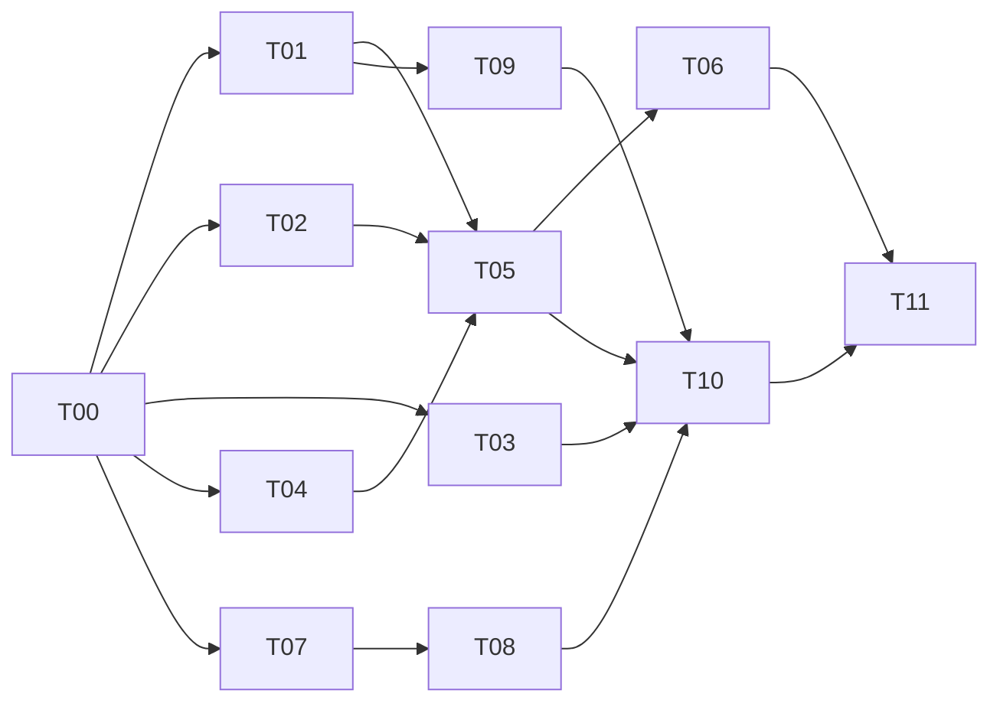

# TapeCI 钱包资源准备 Implementation Plan

> **For agentic workers:** REQUIRED SUB-SKILL: Use superpowers:subagent-driven-development or superpowers:executing-plans to implement this plan task-by-task. Steps use checkbox (`- [ ]`) syntax for tracking.

**Goal:** 用户按钱包选择已有电路，只补齐缺失资源，并完成可恢复的首次发布。

**Architecture:** 复用现有链读取、身份、项目和部署模块；资源发现与准备任务各自拥有契约、API 和持久化。准备任务不塞入部署状态机；先交付已有资源复用，再对接真实供应，最后验收完整购买到发布流程。

**Tech Stack:** 现有 TypeScript、Next.js、Fastify、Viem、Drizzle/PostgreSQL、BullMQ、Vitest、Playwright；不因本计划整体迁移工具链。

**Spec:** [开发规格](../specs/2026-10-27-wallet-resource-provisioning-spec.md)。[产品设计](../../reports/TapeCI-Wallet-Onboarding-and-Release-Design-2026-10-27.md)。

**Status:** 计划已编制，多 Agent 静态审查完成；业务实现及验收未执行。检查基线为当前本地 `main` @ `c5eb8e3` 加现有未提交改动，不代表远程主分支或未提交 UI 已验收。

## Global Constraints

- 首期 X Layer 196；用户钱包逐步支付；不保存用户主钱包私钥。
- 同一容器链上写入串行；双独立 RPC、实现版本、所有权、预算门禁继续有效。
- 输入地址只表示公开查询，不代表身份或支付授权；公开接口不得返回私有项目关联。
- 不改写现有 UI 工作区、不自动提交、推送或发主网交易。后续执行从 `origin/dev` 准备分支；若该 ref 不存在，记录阻塞并先解决基线，不能静默改用 `main`。按用户要求使用最多三个词、连字符分隔、无斜杠或类型前缀的短分支名。
- 新表列采用 snake_case；对现有表仅做增量迁移，不重构全库命名。新增运行时代码不从 web 依赖 API/worker 私有模块。
- 本仓库没有用户最新指令中的 `packages/client`、Protocol/Server HttpApi；当前不执行不存在的 generate。将来若改到这些实际模块，按要求在 client 运行生成，不手改产物。
- 采购接口未验证时只交付目录不可用状态和已有资源开启路径；不得编造购买成功或 mint ABI。
- 本轮只写文档；未运行测试。下面命令均为后续实施验收命令，不是通过记录。

## Review Focus

1. 钱包有多个已验证地址：不能任取一个而误拒合法所有者（T01）。
2. RPC/索引失败：不能被转换成无资产、未开启并诱导付费（T02）。
3. 交易广播后超时或刷新：未知结果必须先核验，不能再次购买/续期（T04、T05）。
4. 草稿期间 push 与仓库 Actions：不创建平台部署/发 token；外部工作流触发与平台门禁分开（T07、T08）。
5. 授权过期和上传中断：重签/继续沿用正确计划、journal 和权限，不重复写入（T09）。

## 1. 多 Agent 审查问题登记

三名独立 Agent 分别检查钱包资源、采购持久化、GitHub/发布；主代理复核关键源码。以下“已确认”均指静态代码证据，尚无本轮运行时复现。

| ID | 分类/优先级 | 源码证据 | 具体问题与影响 | 归属 |
| --- | --- | --- | --- | --- |
| I01 | bug / P0 | `apps/web/components/bind-name-form.tsx:108,166,174` | 无注入 provider 的 WalletConnect 被判不可用；激活页缺少连接入口 | T01 |
| I02 | bug / P1 | `apps/api/src/binding.ts:264` | 只查第一个 verified wallet，多钱包用户合法持有地址可能被拒 | T01 |
| I03 | bug / P0 | `packages/chain/src/container.ts:168–190`; `apps/api/src/container-resolver.ts:17` | 读取异常落成 owner=null/opened=false，被误报未开启 | T02 |
| I04 | bug / P1 | `apps/web/lib/format.ts:65–71` | 非零小额费用固定截断成零 | T03 |
| I05 | bug / P0 | `apps/api/src/binding.ts:174–186`; `routes/containers.ts:333–351` | 广播后等 receipt 才返回 hash 并入库，超时/重启缺乏可恢复依据 | T04 |
| I06 | 缺项 / P0 | `routes/containers.ts:107–121`; `apps/api/src/app.ts:77–90`; `packages/chain/src/abis.ts:63` | 私有已接入容器 API 无法支持匿名钱包发现，也没有 owner 枚举方法 | T02 |
| I07 | 缺项 / P0 | `packages/database/src/schema.ts:374,464,658` | deployment 交易和已确认容器事件无法承载报价/待签/独立准备步骤 | T04 |
| I08 | 外部依赖 / P0 | `packages/chain/src/abis.ts:33,47,63` | open/FEE 不是购买，采购/库存交付接口及商业规则未落实 | T06 |
| I09 | 缺项 / P1 | `packages/chain/src/fees.ts:5`; `routes/containers.ts:290` | 实时费用不是有有效期、指定接收者与逐项 cap 的确认报价 | T04、T05 |
| I10 | 缺项 / P1 | `packages/queue/src/queues.ts:16`; `workers.ts:173`; `worker/runtime.ts:739` | 现有队列绑定 deployment；journal 的存在也意味着不能承诺仅 PG 就能恢复所有部署证据 | T04、T09 |
| I11 | 缺项 / P0 | `schema.ts:203,212`; `routes/projects.ts:94`; `packages/github/src/webhook.ts:353–394` | 草稿/构建启用门禁不存在；push 会创建部署记录，不等于平台已启动构建 | T07 |
| I12 | 缺项 / P0 | `docs/examples/tapeci-actions.yml:7,13,27`; `routes/builds.ts:34,85,121` | workflow 参数固定，缺少开始/失败回报；上传后才补记 BUILDING；同 SHA webhook 重放不是新构建尝试 | T08 |
| I13 | bug / P1 | `project-access.ts:43–63`; `routes/deployments.ts:51–61,379` | 项目可继承组织 owner，审批却仅读直接成员角色 | T09 |
| I14 | 缺项 / P0 | `routes/deployments.ts:375,507,524`; `packages/queue/src/state-machine.ts:93,102`; `worker/runtime.ts:645` | 重签/公开 resume 入口不完整；已有 worker 中断恢复能力应接通，不能另造上传器 | T09 |
| I15 | 缺项 / P1 | `wallet-actions.tsx:142–148`; `projects/[id]/page.tsx:110–116` | payload 获取后立即签名；项目页缺少当前站点聚合结果 | T10 |

执行角色需明确：现有 execute 对可读成员开放，不直接认定为漏洞。本计划建议首次统一为有效角色 maintainer/owner 才能触发付费执行；这是建议的行为变更，T00 需要确认后锁定，不能借修复静默收窄原有权限。

## 2. 契约、文件边界与依赖

| 模块 | 现有/新增文件 | 输出 |
| --- | --- | --- |
| 共享契约 | 新增 `packages/shared/src/resources.ts`, `provisioning.ts`，更新 `index.ts` | 规格 §4 的 DTO；仅共享类型及边界 schema，无数据库运行时 |
| 钱包 | 修改 `components/bind-name-form.tsx`, `wallet-actions.tsx`, `lib/wallet-connectors.ts`；新增 `components/wallet-connection.tsx` | 统一连接、切链、账户状态与错误 |
| 发现 | 修改 `packages/chain/src/container.ts`；新增 `apps/api/src/resources.ts`, `resource-index.ts`, `routes/resources.ts` | 公开查询、增量索引与链上核验 |
| 准备 | 新增 `apps/api/src/provisioning/{quotes,tasks,transactions,providers}.ts`, `routes/provisioning.ts`, `worker/provisioning.ts` | 报价、准备步骤、供应适配、确认恢复；先用 API 内聚模块，不预建多余 package |
| 数据 | 修改 `packages/database/src/schema.ts`；新增递增迁移文件 | 资源索引、准备报价/任务/步骤/交易、草稿与构建尝试 |
| 项目/构建 | 修改 `routes/projects.ts`, `routes/builds.ts`, `packages/github/src/webhook.ts`；新增 `apps/api/src/build-runs.ts` | 草稿、启用、固定 SHA 的运行/失败/重试 |
| 发布 | 修改 `project-access.ts`, `routes/deployments.ts`, `queue/src/state-machine.ts`, `worker/runtime.ts` | 统一权限、重签、resume 和 capability |
| 页面 | 新增 `app/resources/page.tsx`, `app/preparations/[id]/page.tsx`；修改项目、新建、部署、容器页面 | 发现→准备→发布统一流程 |

迁移建议拆为 resource discovery、provisioning、project draft/build 三个增量；分配迁移编号时读取实际最新编号，避免多 Agent 同时创建同号文件。schema.ts、app.ts、共享导出与 i18n 文件由集成人统一修改。

## 3. 开发任务

### T00 — 固定范围、执行策略与验证入口

负责人：主代理/集成人。涉及规格、计划和项目验证脚本；不先修改业务状态。

- [ ] 核对工作区改动及 `origin/dev` 存在性；记录基线与待保留 UI 改动；不 reset 或静默搬动未提交文件。
- [ ] 核对真实供应来源；记录 execute 权限策略的确认结果。构建执行器首期建议沿用仓库 GitHub Actions：平台控制 admission/token/dispatch，而不承诺阻止仓库自身 push workflow 启动。
- [ ] 根据现有链配置和已验证网络行为落实准备交易的确认深度，写入显式网络配置；未落实不开放采购确认判定，不把任意次数或双 RPC 同意当成最终性证明。
- [ ] 当前没有 `.opencode/skills` 匹配文件，也没有 `bun run check` 入口。实施前定位可用测试指引；若确实不存在记录事实。添加根级 `check` 包装既有 lint/typecheck/web 检查，保持锁定依赖，不直接调用 tsc 命令；先验证 Bun 与现有工具链兼容性。
- [ ] 从包目录确认测试发现命令，例如在 `apps/api` 使用 `bun x vitest list --root ../.. --config ../../vitest.config.ts tests/p2`，再运行目标文件；若路径解析不兼容，改成包本地配置并记录最终命令。不得把未发现测试视为通过。

### T01 — 修复钱包连接与多地址权限（R01、R04、R15；I01–I02）

文件：钱包模块所列组件、`apps/api/src/binding.ts`、`routes/wallet.ts`；测试 `tests/p2/web/wallet-connectors.test.ts`、`tests/p2/api/container-bind.test.ts` 及新增钱包 UI 场景。

接口：`WalletConnection` 消费现有 wagmi 配置；`requireBindingAccess` 保留原返回契约，查询匹配的已验证 owner 地址而非任取第一条。

- [ ] 先添加失败用例：无 ethereum 的已连接 WalletConnect、容器页直连、验证 A/B 顺序互换、账户更换。
- [ ] 复用 connector provider 判断，提供连接/切链/更换账户；保持钱包证明和付费授权分离；执行前链上复核 owner。
- [ ] 包目录运行目标 API/组件测试；用真实钱包验收时单列需要用户签名的步骤，不以注入测试替代设备结果。

### T02 — 资源发现与准确链状态（R02–R03、R05–R06；I03、I06）

文件：chain/container、共享 resources、API resources/resource-index、独立索引 migration；新增 `tests/unit/resource-discovery.test.ts`、`tests/p2/api/resources.test.ts`。

接口：`listWalletResources({ chainId, address, cursor }): Promise<WalletResourcePage>`；`inspectResource({ processor, tokenId, blockNumber })` 返回 owner/deployed/opened 与明确读取结果。类型使用规格 §4。

- [ ] 先测试读取异常、真实 unopened、匿名读取、私有字段隔离、大 tokenId、transfer/burn 和部分同步，不满足时失败。
- [ ] 索引 Factory 目录和经过核验的 Transfer 事件；记录 checkpoint，支持分页和限额扫描；选择资源时链上复核。现有私有容器路由不放宽。
- [ ] 在独立数据库验证索引增量/重启；查询失败输出 unavailable/partial，不据此生成采购缺项。fork 用真实 ABI 核验；无可用索引来源先提供手工编号补查且标为非完整枚举。

### T03 — 费用显示与预算输入（R14；I04）

文件：`apps/web/lib/format.ts`、费用/预算消费端；新增 `tests/unit/fee-display.test.ts`，修改相关 web 测试。

接口：保留 `formatWeiAsOkb(wei: string | null): string`，使用 BigInt 与字符串精度；报价详情始终能查看精确 wei。

- [ ] 先断言 zero、1 wei、99999999999999 wei、100000000000000 wei、超安全整数大额和 null；正值不得显示零。
- [ ] 提供足够精度的 OKB 展示，预算支持明确单位换算；估计、cap、实际费用分列，不混币相加。
- [ ] 执行单位转换及页面断言；保留已有格式调用的类型兼容性。

### T04 — 准备持久化与交易恢复基础（R08–R09；I05、I07、I10）

文件：数据库 schema/migration、provisioning/tasks/transactions、worker/provisioning、API 注册；新增 `tests/p2/provisioning/persistence.test.ts`、`transactions.test.ts`。

接口：`createPreparationTask({ userId, quoteId, idempotencyKey })`、`getPreparationTask(userId, taskId)`、`reconcilePreparationStep(taskId, stepId)`；表为 resource_quotes、provisioning_tasks、provisioning_steps、provisioning_transactions。返回共享 DTO。

- [ ] 先测并发相同键、同键不同 payload 冲突、跨用户访问拒绝、确认前不可完成、数据库重连和 worker 重投。
- [ ] 记录报价和钱包快照，步骤使用条件状态更新。签名前保存意图，返回 hash 后立即存 submitted，再异步验收；用户钱包已广播但尚未回传 hash 时保留待核验状态，支持找回原交易，不能自动再次付费。
- [ ] 修复现有 operator bind 的 hash/receipt 顺序并接入同样的跟踪原则：先持久化发送意图，取得 hash 后立即记录。广播与落库之间仍可能中断，不承诺 exactly-once；未知状态阻止自动重发，保留人工核对入口。
- [ ] 将 `apps/web/components/bind-name-form.tsx` 现有直接钱包激活路径同样接入交易记录和核验，不再收到 hash 就视为完成；验证钱包广播后刷新、pending、replacement、revert 和确认后链上状态复查，确保旧入口不遗留恢复断点。
- [ ] 核验实际 chain/from/to/value/calldata 与步骤/报价匹配，禁止历史哈希或相同步骤以外的交易重复归因；新增历史哈希、不同订单同资源、错误 value/calldata 测试。外部自行补齐资源可以 skip，不能伪记为平台已收款，T06 外部跳转同样适用。
- [ ] 保存 blockHash/number，按 T00 显式确认策略和规范链检查进入 confirmed；加入 receipt 消失、同高度换 hash、双 RPC 分歧用例。发生变化退回待核验并暂停下一付费步骤，复用既有链检查能力，不新增通用跨链最终性系统。
- [ ] 使用独立 PostgreSQL 验证 migration up/down、数据恢复、重复 job、API/worker 重启；不停止共享容器。receipt 核验包含目标事件/资源，replacement/cancel 用真实发送方 nonce 和状态核对，不凭提交任意 txHash 即确认交付。

### T05 — 已有电路的报价与开启（R06–R09；I09）

文件：provisioning/quotes、providers、routes/provisioning、chain 开启编码及 resources/preparations 页面；新增 `tests/p2/provisioning/open.test.ts`、fork 开启场景。

接口：`createPreparationQuote({ userId, recipient, resource, options }): Promise<PreparationQuote>`、`prepareStepTransaction(taskId, stepId)` 返回 chainId/to/value/data 和解释；`submitStepHash(taskId, stepId, txHash)` 只登记，不直接完成。

- [ ] 先测已开启 skip、有电路仅 open、费用过期/涨价重新确认、钱包不一致和零月费非零 gas。
- [ ] 用已验证 open/FEE/accountOf/isOpened/isDeployed 生成并验收逐步开启交易。登录且验证交付钱包后才能建立付费任务；开通不能误标为发布。
- [ ] 在 fork 完成拒签、pending、revert 和部分成功恢复；两家 RPC 核验资源结果。钱包层面签名仍由用户执行。

### T06 — 首个真实供应与平台库存（R07、R10；I08）

依赖：真实供应协议、价格、交付和退款规则。文件：`provisioning/providers.ts` 及首个供应模块、目录 API/页面；新增 `tests/p2/provisioning/provider-contract.test.ts`。

接口：供应适配器提供 `listOffers`、`quoteAcquisition`、`prepareAcquisition`、`verifyDelivery` 四种能力；沿用 T04–T05 的报价、交易和结果 DTO，不另造订单。

- [ ] 无来源先测试 unavailable，确保不能购买；取得已验证接口/ABI后写来源、币种、收款、资源及退款约定的契约测试。
- [ ] 实现一个来源；外部跳转使用 pending_external，回来重新查所有权；平台库存验收残留 operator、内容和域名，未达交付条件不完成。
- [ ] 在供应 sandbox/fork 验证错误接收者、错误 NFT、receipt 成功未交付和部分成功；真实采购验收须另有明确金额与目标。该任务阻塞不阻碍 T01–T05 和项目发布修复。

### T07 — 项目草稿与构建门禁（R11；I11）

文件：schema/migration、routes/projects、共享项目 DTO、new-project-form、packages/github/src/webhook、routes/builds；新增 `tests/p2/api/project-drafts.test.ts` 和 webhook/OIDC 门禁测试。

接口：`createProjectDraft`、`updateProjectDraft`、`finalizeProjectDraft`；正式项目增加 `build_enabled`，迁移旧项目保持原行为，新项目默认 false；`setBuildEnabled(projectId, enabled)` 复用项目写权限。

- [ ] 先测无容器草稿、越权、未启用 push 不创建部署、OIDC 不发 token、正式启用选择 commit、重复启用幂等。
- [ ] 草稿用单独表，正式化时解析容器并验证 installation；server/webhook/token/手动入口共用 admission。记录未触发原因，不自动重放历史 push。
- [ ] 说明平台门禁只控制平台 admission；独立仓库 Actions 已开始运行时不会被“前端禁用”神奇停止。工作流适配在 T08 验收。

### T08 — 实际构建执行、日志与重试（R12；I12）

文件：build-runs、routes/builds、GitHub 集成模块、`docs/examples/tapeci-actions.yml`、schema 构建尝试迁移、部署详情页；新增 `tests/p2/github/build-runs.test.ts`。

接口：`triggerProjectBuild({ projectId, commitSha, configVersion, retryOf })`，返回 attemptId 与 dispatch 状态；`recordBuildRunEvent` 记录 run/job/attempt 和 started/failed/succeeded；artifact 绑定确定 attempt。

- [ ] 先测构建步骤失败可见、同 SHA 新 attempt、重复回调幂等、配置版本一致、未启用拒绝、安装被撤销。
- [ ] 首期沿用仓库 Actions；核验 workflow 支持 dispatch、固定 checkout SHA、参数/配置获取及 OIDC claims。需要 GitHub App 权限扩展时明确记录，未经授权不扩大安装权限。
- [ ] 将 run/job 链接与失败步骤呈现在 UI；日志访问沿用项目权限，输出按已有 secret 屏蔽策略。不能把 RECEIVED 当正在构建，也不能上传 artifact 后才首次知道构建开始。
- [ ] 使用真实仓库受控 workflow 验收配置生效与失败回报；离线测试通过不等于真实 dispatch 成功。

### T09 — 发布权限、重签及中断恢复（R13、R17；I13–I14）

文件：project-access、routes/deployments、state-machine、worker/runtime、console-views、相关 queue/API 测试。

接口：统一 `getDeploymentCapabilities(userId, deploymentId)`；`requestDeploymentReapproval(deploymentId)` 和 `resumeDeployment(deploymentId)` 返回状态/原因，不在前端硬编码权限。

- [ ] 先测组织继承 owner、直接 owner、member 权限矩阵；执行角色按 T00 明确策略测试，不能以本任务名义默改权限。
- [ ] 增加明确重签迁移，作废旧授权并复核 manifest/owner/预算；接通现有 UPLOAD_INTERRUPTED worker/journal 恢复，不重写上传器。未知 pending 先核验，有效授权不足则重签。
- [ ] 核验过期旧签名不可执行、新签名可继续、已有 chunk 不重复写、双 RPC 分歧仍停止；API/worker 重启时同时保留并检验 journal 依赖，不能仅测 PG 即宣称完整恢复。

### T10 — 状态对应 UI 与完整项目结果（R13、R16、R18；I15）

文件：wallet-actions、plan-panel、项目/部署/容器页、lib/api/types/actions/i18n、live-refresh、webhooks 页面及 e2e。

接口：签名分为 load payload → review → sign，展示和签名使用同一 payload；`getProjectPublicationSummary(projectId)` 返回当前 release、binding、publicUrl、gatewayCheck、checkedAt 与缺项，不混入历史部署结果。

- [ ] 先测摘要字段与签名逐项相同、账户/过期变更需重审、LIVE 但未激活、激活但 HTTP 失败、历史部署非当前版本。
- [ ] 状态对应主操作置前；失败先显示日志与恢复，待审批先显示费用/摘要；保留所有证据和原功能入口。live stream 失效提供更新时间与手动刷新。
- [ ] Webhook→run→attempt→deployment 可追溯；仓库读取失败提供重试。中英文、390/1440、键盘、axe 验收，更新功能对照清单说明每个旧入口去向。

### T11 — 独立最终验收与交付

负责人：未参与实现的 reviewer/QA Agent。新增 `docs/evidence/resource-provisioning/` 证据索引及验收报告。

- [ ] 对照规格 AC01–AC12，逐项记录环境、commit、实际命令、预期/实际结果和证据路径；未运行场景明确未验证。
- [ ] 独立 PostgreSQL、fork、GitHub 测试仓库、真实设备分别验收；WalletConnect 扫码、硬件签名和真实主网付费不能以 mock 代替。
- [ ] 根目录运行适配后的 `bun run check`；从包目录运行目标 Vitest/Playwright 和相关回归。测试工具适配以 T00 验证的命令为准，禁止未发现测试或缺凭据的跳过结果冒充成功。
- [ ] 有真实供应后验收全新钱包完整购买闭环；否则可发布已有资源复用版本，采购明确不可用。最终报告分开记录真实验证、fork/本地验证、外部阻塞。

## 4. 并行执行与集成策略

- 批次 A：钱包 T01、资源 T02、费用 T03 并行；主代理完成 T00 并集中维护契约/迁移。
- 批次 B：准备基础 T04、草稿 T07 可并行；T05 等 T01/T02/T04，T08 等 T07。
- 批次 C：T06 在供应材料到位后执行；T09 与准备 UI 可分工，避免同时修改审批组件。
- 批次 D：T10 集成后由独立 Agent 执行 T11。采购和已有资源路径分别验收，不能用一条路径代替另一条。
- 每项任务完成需交接文件、契约变化、测试命令/结果、尚未验证事实。共享 schema/app 注册/i18n 变更经主代理串行集成，避免“并行开发”制造合并冲突。

## 5. 覆盖检查

| 规格 | 任务 | 主要验收 |
| --- | --- | --- |
| R01–R06 | T01、T02、T05 | AC01、AC02、AC04、AC05 |
| R07–R10 | T04–T06 | AC03、AC06、AC07 |
| R11–R12 | T07–T08 | AC08、AC09 |
| R13–R15 | T01、T03、T09–T10 | AC06、AC10、AC12 |
| R16–R18 | T09–T11 | AC10–AC12 |

自检：R01–R18 和 I01–I15 均有归属；五项 Review Focus 已落到对应测试。未将采购外部依赖、真实签名、真实付费、部署 journal 恢复或 workflow 控制伪装为已实现能力。下一步实施采用用户指定的多 Agent 方式，本轮交付止于规格与开发计划。

三组 Agent 已复核最终计划；发布组通过，资源组与准备组提出的旧激活入口恢复、短分支命名、交易实际字段归因和规范链确认补充均已并入。静态文档检查通过不代表业务测试通过。
